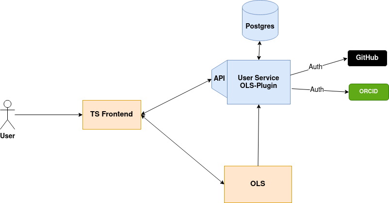

# TS Plugin for TIB Terminology Service V2.0

The Plugin services for adding extra features to a Terminology Service. 

Implemented as part of [TIB](https://terminology.tib.eu/ts) and [NFDI4Chem](https://terminology.nfdi4chem.de/ts/) Terminology Services. 

Hosted: https://service.tib.eu/ts-plugin





## Tasks
- Authentication 
- Note for semantic artifacts
- Term request and issue report
- User defined Collection
- Advanced search setting storage
- Contact form
- Ontology suggestion


## Test
Run tests through the local running script and virtual environment:

```bash
PYTHON=.venv/bin/python scripts/local-dev.sh test
```

Arguments to the script are passed to `manage.py`; this mode does not start the web server or worker.


### Authentication code for testing
The authentication (test_login.py) Test part requires the login code as input. You need to manually create the login code by opening these links and authenticate yourself:

- Github: https://github.com/login/oauth/authorize?scope=user&client_id=b2c81399376da40700c9

- ORCID: https://sandbox.orcid.org/oauth/authorize?response_type=code&scope=/authenticate&client_id=APP-6W3MM8J52OXM6DYD&redirect_uri=http://www.localhost:3000/ts/

After you autheticate, copy the code (after code= in the url) in to the env variable name "GITHUB_LOGIN_CODE" and "ORCID_LOGIN_CODE" (for Github and ORCID) in the .env file (look at .env.example in the user_service directory).

### Other tests

For the other tests, just use a valid token in the .env file for test. (To avoid producing new login code each time). Vars to use are:

- GITHUB_TEST_ACCESS_TOKE
- ORCID_TEST_ACCESS_TOKE
- ORCID_LOGIN_USERNAME


## Email notifications

Emails use a shared helper and queue a Celery task after the database transaction commits. Content reports are one use: they notify system admins with an email address for the report's terminology service. Temporary SMTP failures retry up to five times with backoff; permanent failures are logged.

### Database email log

Apply the migration before using the email feature (the normal local startup also applies migrations):

```bash
PYTHON=.venv/bin/python scripts/local-dev.sh migrate
```

Migration `user/0010_email_log.py` creates the `email_logs` table. Each recipient has a separate entry containing the sender, recipient, subject, notification type, optional reference and terminology service, creation/submission timestamps, attempt count, and last error. Message bodies are not stored in the database.

| Status | Meaning |
| --- | --- |
| `queued` | Waiting for the worker or a temporary-failure retry. |
| `submitted` | The SMTP server accepted the message; inbox delivery is not confirmed. |
| `captured` | A development backend accepted the message, such as console or file output. |
| `failed` | Submission failed permanently, retries were exhausted, or queue publishing failed. |

Other notification features can use the same helper:

```python
from user_service.libs.email import Email

Email("Subject", "Message body", client_ts="general").send(
    ["recipient@example.org"],
    notification_type="general",
    reference="optional-reference",
)
```

The helper returns the created log entries. Content reports use `notification_type="content_report"` and a `report:<id>` reference. If Redis cannot accept a task, its log becomes `failed` and the report remains created. This log is not a durable outbox: the body exists only in the Celery message, and failed queue publishing is not retried automatically.

### Local development

Use the running script as usual:

```bash
PYTHON=.venv/bin/python scripts/local-dev.sh
```

The script defaults to Django's console email backend, so messages appear in the worker's terminal output without sending real email. Postgres must already be available; the script starts Redis and the Celery worker.

To save messages instead, set `EMAIL_BACKEND=django.core.mail.backends.filebased.EmailBackend`. Files default to `logs/emails`; override `EMAIL_FILE_PATH` to use another directory.

To test real delivery, install and configure Postfix on the host, listening on loopback and accepting submissions only from localhost, then run:

```bash
PYTHON=.venv/bin/python \
EMAIL_BACKEND=django.core.mail.backends.smtp.EmailBackend \
EMAIL_HOST=127.0.0.1 EMAIL_PORT=25 \
SYSTEM_EMAIL=notifications@example.org \
scripts/local-dev.sh
```

Host Postfix installation and startup are separate from the running script. Direct delivery from a local machine also needs suitable network access and sender DNS; use the console backend for routine development.

### Production

Docker Compose runs Postfix separately from the app and worker. Both submit to `postfix:25` on a dedicated mail network; no SMTP port is published to the host. Postfix delivers directly to recipient mail servers without an upstream SMTP relay. Its queue is stored in the `postfix_queue` volume, which must be retained across deployments.

Set the real sender address in the app's environment, using `user_service/.env.example` as a reference:

```dotenv
SYSTEM_EMAIL=notifications@example.org
EMAIL_TIMEOUT=10
```

Use a monitored sender address that can receive delivery failures. Compose supplies the SMTP backend, host and port for the app and worker. Existing `EMAIL_SERVER_HOST` and `EMAIL_SERVER_PORT` remain fallback settings outside Compose.

Export the public mail hostname before deploying:

```bash
export POSTFIX_HOSTNAME=mail.example.org
docker compose up -d --build
```

`POSTFIX_HOSTNAME` is read by Compose from its shell environment or project-level `.env`; it is separate from the app's `user_service/.env` file. Replace the example domain and configure:

- A stable public sending IP with outbound TCP port 25 permitted.
- Forward DNS for the mail hostname and matching reverse DNS (PTR) for the sending IP.
- SPF authorizing that IP, DKIM signing, and DMARC for the sender domain. This setup does not include a DKIM signer; provision one separately and connect it to Postfix before relying on production delivery.

The mail network uses `172.30.25.0/29`. Only the app (`172.30.25.2`) and worker (`172.30.25.3`) are trusted to relay. If that subnet conflicts with your infrastructure, update both `docker-compose.yml` and the allowlist in `docker/postfix/main.cf` together.

Postfix logs to container stdout; application submission failures go to the configured service logs. SMTP acceptance means the message entered Postfix's queue, not that it reached an inbox. After acceptance, Postfix handles onward delivery retries and bounces.

## License

MIT License
