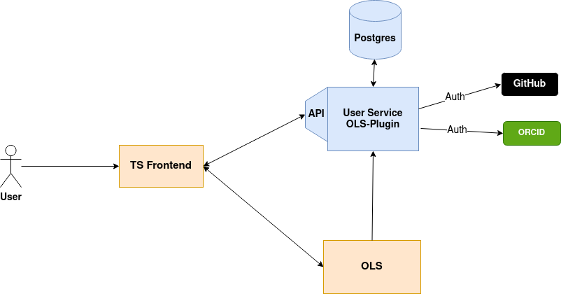

# TS Plugin for TIB Terminology Service V2.0

The Plugin services for adding extra features to a Terminology Service. 

Implemented as part of [TIB](https://terminology.tib.eu/ts) and [NFDI4Chem](https://terminology.nfdi4chem.de/ts/) Terminology Services. 

Hosted: https://service.tib.eu/ts-plugin





## Tasks
- Authentication 
- Note for semantic artifacts
- Term request and issue report
- User defined Collection
- Advanced search setting storage
- Contact form
- Ontology suggestion


## Test
Run tests through the local running script and virtual environment:

```bash
PYTHON=.venv/bin/python scripts/local-dev.sh test
```

Arguments to the script are passed to `manage.py`; this mode does not start the web server or worker.


### Authentication code for testing
The authentication (test_login.py) Test part requires the login code as input. You need to manually create the login code by opening these links and authenticate yourself:

- Github: https://github.com/login/oauth/authorize?scope=user&client_id=b2c81399376da40700c9

- ORCID: https://sandbox.orcid.org/oauth/authorize?response_type=code&scope=/authenticate&client_id=APP-6W3MM8J52OXM6DYD&redirect_uri=http://www.localhost:3000/ts/

After you autheticate, copy the code (after code= in the url) in to the env variable name "GITHUB_LOGIN_CODE" and "ORCID_LOGIN_CODE" (for Github and ORCID) in the .env file (look at .env.example in the user_service directory).

### Other tests

For the other tests, just use a valid token in the .env file for test. (To avoid producing new login code each time). Vars to use are:

- GITHUB_TEST_ACCESS_TOKE
- ORCID_TEST_ACCESS_TOKE
- ORCID_LOGIN_USERNAME


## Email notifications

Emails use a shared helper and queue a Celery task after the database transaction commits. Content reports are one use: they notify system admins with an email address for the report's terminology service. Temporary SMTP failures retry up to five times with backoff; permanent failures are logged.

### Database email log

Apply the migration before using the email feature (the normal local startup also applies migrations):

```bash
PYTHON=.venv/bin/python scripts/local-dev.sh migrate
```

Migration `user/0010_email_log.py` creates the `email_logs` table. Each recipient has a separate entry containing the sender, recipient, subject, notification type, optional reference and terminology service, creation/submission timestamps, attempt count, and last error. Message bodies are not stored in the database.

| Status | Meaning |
| --- | --- |
| `queued` | Waiting for the worker or a temporary-failure retry. |
| `submitted` | The SMTP server accepted the message; inbox delivery is not confirmed. |
| `captured` | A development backend accepted the message, such as console or file output. |
| `failed` | Submission failed permanently, retries were exhausted, or queue publishing failed. |

Other notification features can use the same helper:

```python
from user_service.libs.email import Email

Email("Subject", "Message body", client_ts="general").send(
    ["recipient@example.org"],
    notification_type="general",
    reference="optional-reference",
)
```

The helper returns the created log entries. Content reports use `notification_type="content_report"` and a `report:<id>` reference. If Redis cannot accept a task, its log becomes `failed` and the report remains created. This log is not a durable outbox: the body exists only in the Celery message, and failed queue publishing is not retried automatically.

### Local development

Use the running script as usual:

```bash
PYTHON=.venv/bin/python scripts/local-dev.sh
```

The app and Celery worker read their email configuration from `user_service/.env`. Mailgun uses `smtp.mailgun.org:587` with STARTTLS and SMTP authentication. Postgres and Redis must already be available; the script starts the Celery worker.

To save messages instead, set `EMAIL_BACKEND=django.core.mail.backends.filebased.EmailBackend`. Files default to `logs/emails`; override `EMAIL_FILE_PATH` to use another directory.

Set `EMAIL_HOST_USER` and `EMAIL_HOST_PASSWORD` to your Mailgun SMTP credentials and `SYSTEM_EMAIL` to a sender on your Mailgun domain. Sandbox domains can send only to authorized recipients. To print messages without sending email, explicitly set `EMAIL_BACKEND=django.core.mail.backends.console.EmailBackend`.

### Production

Configure the deployed `user_service/.env` for both the app and worker, using `user_service/.env.example` as a reference. No Postfix container is required:

```dotenv
SYSTEM_EMAIL=notifications@example.org
EMAIL_BACKEND=django.core.mail.backends.smtp.EmailBackend
EMAIL_HOST=smtp.mailgun.org
EMAIL_PORT=587
EMAIL_HOST_USER=your-mailgun-smtp-login
EMAIL_HOST_PASSWORD=your-mailgun-smtp-password
EMAIL_USE_TLS=True
EMAIL_USE_SSL=False
EMAIL_TIMEOUT=10
```

Keep credentials in the untracked `.env` file. Environment variables override `.env` values. Existing `EMAIL_SERVER_HOST` and `EMAIL_SERVER_PORT` remain fallback settings when `EMAIL_HOST` and `EMAIL_PORT` are absent.

Application submission failures go to the configured service logs. SMTP acceptance means the relay accepted the message, not that it reached an inbox.

## License

MIT License
